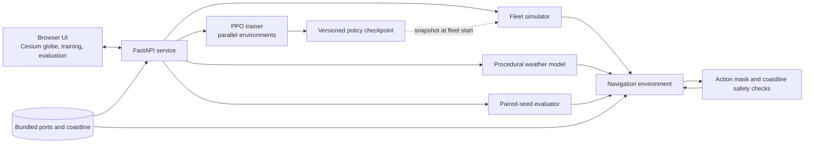

# NAVRUNA

**Maritime Research Simulator and Reinforcement Learning Lab**

NAVRUNA is a local research application for experimenting with autonomous vessel navigation in a synthetic ocean environment. It combines a 3D fleet simulator, a Proximal Policy Optimization (PPO) training workflow, procedural weather, and fixed-seed policy evaluation.

NAVRUNA is intended for software development, reinforcement-learning research, and classroom demonstrations. It is not a navigation system and must not be used to operate real vessels or make safety-critical decisions.

## About

The application simulates port-to-port voyages using a bundled port catalog and coastline data. A browser-based Cesium globe displays vessel movement, environment conditions, and telemetry. The backend runs the navigation environment, applies a coastline safety shield, and manages policy training and evaluation.

Weather and voyage conditions are synthetic and seeded for repeatable experiments. Browser map imagery and CesiumJS assets are loaded from external providers, so the full browser experience requires an internet connection by default even though simulation inputs are local.

### Key capabilities

- Simulate fleets of 10–300 vessels on a 3D globe.
- Inspect vessel telemetry, recent tracks, voyage outcomes, and fleet metrics.
- Explore procedural wind, waves, currents, and storm conditions.
- Train a shared PPO navigation policy with configurable transition targets and parallel environments.
- Run paired-seed evaluations against the bootstrap steering baseline and, when available, a trained checkpoint.
- Save and load versioned scenarios, and export simulation records, tracks, training reports, and evaluation results as JSON.

## Requirements

- Windows with PowerShell for the included launcher.
- Python 3.11, 3.12, or 3.13.
- Internet access for the browser-hosted CesiumJS assets and OpenStreetMap imagery.
- An NVIDIA GPU is optional. The application can run on CPU; the launcher can install CUDA-enabled PyTorch when a supported NVIDIA setup is detected.

The launcher installs dependencies from `requirements.txt` into a local `.venv` when needed. Initial setup may take several minutes, depending on the network and whether PyTorch needs to be installed.

## Quick start

From the project directory, run either command:

```powershell
.\run_navruna.bat
```

or:

```powershell
.\start.ps1
```

The launcher starts the API and frontend, waits for both to respond, and opens the simulator in your browser.

| Service | Address |
| --- | --- |
| Simulator | [http://127.0.0.1:8080/](http://127.0.0.1:8080/) |
| Training Lab | [http://127.0.0.1:8080/training.html](http://127.0.0.1:8080/training.html) |
| Evaluation | [http://127.0.0.1:8080/analytics.html](http://127.0.0.1:8080/analytics.html) |
| API health | [http://127.0.0.1:8000/api/health](http://127.0.0.1:8000/api/health) |
| Interactive API documentation | [http://127.0.0.1:8000/docs](http://127.0.0.1:8000/docs) |

### Manual local setup

Use this option if you prefer to start the services yourself. Open two PowerShell terminals from the project directory.

Create the environment and install dependencies once:

```powershell
py -3.12 -m venv .venv
.\.venv\Scripts\python.exe -m pip install --upgrade pip
.\.venv\Scripts\python.exe -m pip install -r requirements.txt
```

In the first terminal, start the API:

```powershell
.\.venv\Scripts\python.exe -m uvicorn backend.main:app --host 127.0.0.1 --port 8000
```

In the second terminal, serve the browser interface:

```powershell
Set-Location frontend
..\.venv\Scripts\python.exe -m http.server 8080
```

Then open [http://127.0.0.1:8080/](http://127.0.0.1:8080/) in a browser. Keep both terminals running while using the application.

## How to use

### Run a fleet simulation

1. Open the Simulator and set the scenario seed and fleet size in Mission Control.
2. Optionally save the scenario to a JSON file or load a previously saved scenario. Loaded scenarios are checked against the local data and weather-model versions.
3. Select **Start Simulation** to generate the fleet. Use **Step +1H** for a single simulated hour, or start continuous simulation.
4. Choose a simulation speed of 1, 2, 5, or 10 simulated hours per second. The default is 1 hour per second.
5. Select a vessel on the globe to inspect its telemetry and recent track. Export the run record or selected vessel trace when needed.
6. Use the weather controls to show synthetic wind, waves, current, or storm layers and inspect values on the globe.

Starting a fleet captures a snapshot of the available controller. A later training run will not change the policy used by that fleet.

### Train the navigation policy

1. Open the **Training Lab** from the top navigation or visit `/training.html`.
2. Set a transition target, number of parallel environments, and learning rate. The default settings are 250,000 transitions, 64 environments, and a learning rate of 0.0003.
3. Select **Start Training**. Training progress, episode metrics, optimization diagnostics, and activity logs update on the page.
4. Enable **Continue until stopped** for a continuous run, or use **Stop Training** to stop after the current PPO update.
5. Export the run report as JSON if you need to preserve its settings and metrics.

Training can run while an existing fleet continues using its controller snapshot. A newly started fleet cannot initialize while training is active. A trained checkpoint is used for fleet control only when its model and navigation-interface versions are compatible; otherwise NAVRUNA uses the bootstrap steering controller.

### Evaluate controllers

1. Open **Evaluation** from the top navigation or visit `/analytics.html`.
2. Choose the number of voyages and a starting seed.
3. Select **Run Paired Evaluation**. Available controllers receive the same seed range so their results can be compared on matching scenarios.
4. Download the report as JSON for further analysis.

Evaluation is a small synthetic research benchmark. Its sample count and confidence intervals are descriptive; they do not establish real-world safety or statistical significance.

## Architecture



### Main components

- **Browser interface (`frontend/`)** — provides the globe, simulation controls, weather overlays, training telemetry, and evaluation reports.
- **FastAPI service (`backend/`)** — exposes simulation, training, evaluation, weather, scenario, and local-data endpoints. The included launcher binds it to `127.0.0.1:8000`.
- **Fleet simulator (`model/simulation/`)** — creates vessels, advances voyages, records outcomes, and uses a controller snapshot captured when the fleet starts.
- **Navigation environment (`model/rl/navigation_env.py`)** — defines observations, actions, rewards, vessel movement, and voyage termination.
- **Safety and geography (`model/navigation/`, `data/`)** — checks course actions against the bundled coastline and a land-clearance buffer before movement.
- **Weather model (`model/weather/`)** — produces deterministic, procedural ocean conditions from a seed and simulation time.
- **PPO trainer and evaluator (`model/rl/`)** — train a shared policy in parallel environments and compare available controllers over paired seeds.

The policy selects among nine ordinary course changes and a learned recovery action. The safety shield independently validates the selected course; it remains in force during fleet simulation, training, and evaluation. Fleet vessel classes use different cruise speeds, while training samples across the supported speed range.

For further implementation detail, see [Architecture](docs/ARCHITECTURE.md) and the [PPO Model Card](docs/MODEL_CARD.md).

## API overview

The full request and response schemas are available through the interactive documentation at `/docs`.

| Endpoint | Purpose |
| --- | --- |
| `GET /api/health` | Check that the local API is responding. |
| `POST /api/simulation/start` | Initialize a fleet from a seed or validated scenario. |
| `POST /api/simulation/step` | Advance the fleet by the requested number of simulated hours. |
| `GET /api/simulation/state` | Read the current fleet, run metadata, and scenario. |
| `GET /api/simulation/training` | Read training status, progress, and history. |
| `POST /api/simulation/train` | Start a PPO training run. |
| `POST /api/simulation/train/stop` | Request that an active training run stop. |
| `POST /api/simulation/evaluate` | Run a paired-seed controller evaluation. |
| `GET /api/simulation/scenario/schema` | Retrieve the current scenario JSON Schema. |
| `GET /api/simulation/scenario/template` | Create a local scenario template with dataset fingerprints. |
| `GET /api/simulation/weather` | Retrieve a synthetic weather grid. |
| `GET /api/simulation/ports`, `GET /api/simulation/coastline` | Retrieve the local map data used by the application. |

## Project structure

```text
backend/             FastAPI application and simulation API
data/                Bundled ports, coastline, and data notes
docs/                Architecture, model card, and project reports
frontend/            Simulator, training, and evaluation interfaces
model/navigation/    Geography and coastline safety checks
model/rl/            Navigation environment, PPO trainer, evaluation
model/simulation/    Fleet simulator and vessel behavior
model/weather/       Procedural weather model
tests/               Automated regression tests
```

## Development and tests

Run the existing regression suite from the project directory:

```powershell
.\.venv\Scripts\python.exe -m pytest -q
```

The main implementation settings are in `requirements.txt` and `pyproject.toml`. The Windows launcher is `start.ps1`; `run_navruna.bat` is a convenience entry point.

## Data, security, and limitations

- Simulation inputs are local and synthetic. The browser loads CesiumJS assets and OpenStreetMap imagery from external providers by default.
- The bundled coastline is identified as GSHHS-derived in [`data/README.md`](data/README.md). Review the data documentation and source licensing before redistributing the project or its data.
- Vessel dynamics and fuel use are simplified. NAVRUNA does not include validated bathymetry, live AIS, historical weather replay, operational route planning, validated encounter or COLREGS behavior, or evidence of real-world navigational safety.
- The local API is configured for loopback use and has no authentication. Do not expose it to a public network without adding authentication, request limits, and a deployment security review.
- Synthetic weather is not a forecast, and simulated performance is not evidence of real-world voyage performance or regulatory compliance.

## Documentation

- [Architecture](docs/ARCHITECTURE.md)
- [PPO Model Card](docs/MODEL_CARD.md)
- [Data notes](data/README.md)
- [Bug and reliability report](docs/BUG_REPORT.md)

